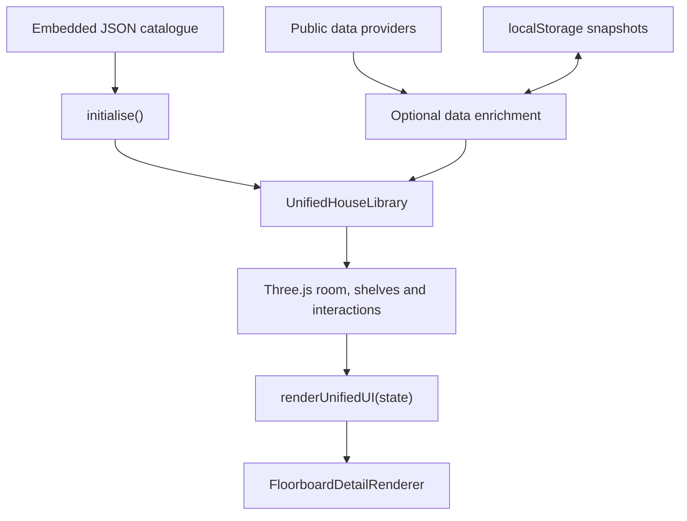

<div align="center">

# 📚 PUNIT'S LIBRARY
### One Bookcase. Three Tiers.

**Not another portfolio grid. A 3D walnut library you can explore.**

<p>
  <a href="https://threejs.org/"></a>
  <a href="https://developer.mozilla.org/en-US/docs/Web/JavaScript"></a>
  <a href="https://developer.mozilla.org/en-US/docs/Web/HTML"></a>
  <a href="https://developer.mozilla.org/en-US/docs/Web/CSS"></a>
  
  
  
</p>

<p>
  
  
  
</p>

<p>
  <a href="#-explore-the-library">🧭 Explore</a> &nbsp;·&nbsp;
  <a href="#-run-it-locally">⚡ Quick start</a> &nbsp;·&nbsp;
  <a href="#-controls">🎮 Controls</a> &nbsp;·&nbsp;
  <a href="#-make-it-yours">🎨 Customize</a> &nbsp;·&nbsp;
  <a href="#-under-the-hood">🧱 Architecture</a>
</p>

**Created by [Punit Pritam Mohanty](https://github.com/Punitpritam788)**

</div>

---

## ✨ The idea

What if a portfolio felt less like a webpage and more like a place?

**Punit's Library** turns a personal portfolio into a full-screen, interactive 3D wooden study. Visitors enter through a cinematic ceiling introduction, explore a dark-walnut bookshelf, pull out individual volumes, inspect 3D collectibles, and discover selected details on the wooden floorboards.

The room is not just decoration. **The room is the interface.**

> One bookcase. Three tiers. A personal archive built to be explored.

## ⚡ Quick start

Want to step inside first? Start a local server from the project folder:

```bash
python -m http.server 8000
```

Then open **http://localhost:8000/punit_library_three_tier_walnut_bookshelf_documented.html**. If you rename the file to `index.html`, you can use **http://localhost:8000/** instead. No install command or build process is needed. See [Run it locally](#-run-it-locally) for requirements and deployment notes.

## 🧭 Explore the library

<table>
  <tr>
    <td width="33%" valign="top">
      <h3>📘 01 - Projects & Chapters</h3>
      <p><strong>30 starting volumes</strong></p>
      <p>Personal chapters, selected concepts, and curated GitHub repositories. Open a volume to discover project details and follow repository or demo links.</p>
      <p><sub>7 personal chapters · 2 concept projects · 21 curated repository entries</sub></p>
    </td>
    <td width="33%" valign="top">
      <h3>📖 02 - Manga & Manhwa</h3>
      <p><strong>22 starting volumes</strong></p>
      <p>A collection with distinct reading interactions. Japanese manga follows right-to-left direction, while Korean manhwa follows left-to-right direction.</p>
      <p><sub>Cover lookups · Animated covers · Two-page preview</sub></p>
    </td>
    <td width="33%" valign="top">
      <h3>🎮 03 - Games & Discs</h3>
      <p><strong>16 fallback titles</strong></p>
      <p>PS5 and PC game cases, spinning optical discs, a CD carousel, an insert-disc animation, and 3D gaming collectibles.</p>
      <p><sub>Platform filters · Case inspection · Collectibles</sub></p>
    </td>
  </tr>
</table>

<sub>Counts describe the embedded starting catalogue. Live GitHub and game-trend synchronization can change the displayed collections.</sub>

## 🎯 What makes it different?

| Experience | What you can do |
| --- | --- |
| 🏠 **Explore a 3D room** | Move between the ceiling introduction, bookshelf, and floor-detail views. |
| 📚 **Interact with volumes** | Select, pull out, open, and return books or game cases. |
| 🪵 **Read the floorboards** | View item details and clickable actions rendered directly into the wooden floor texture. |
| 🧩 **Inspect collectibles** | Rotate and zoom selected 3D objects. |
| 🔄 **Refresh public data** | Sync public GitHub repositories and attempt game-trend updates. |
| 📱 **Use touch-friendly controls** | Browse shelves, swipe reader previews, and use compact mobile controls. |

### More than a visual bookshelf

- **A searchable GitHub directory** gives visitors another way to find repositories.
- **Live repository enrichment** can refresh public repository metadata and load README descriptions when a project is opened.
- **Manga/manhwa directionality** changes the cover hinge and page navigation direction.
- **Game presentation modes** let visitors switch between the bookshelf and CD carousel.
- **Responsive HUD controls** adapt to narrow and short screens, with a landscape suggestion for the wide composition.
- **Reduced-motion support** respects selected `prefers-reduced-motion` settings.

> **Reader note:** The manga/manhwa spread is an interaction preview with generated sample text. It does not contain scanned copyrighted pages and is not a full digital reading service.

## 🛠️ Built with

| Technology | How it is used |
| --- | --- |
| **Three.js 0.185.0** | 3D room, camera, shelves, books, cases, collectibles, raycasting, and animation |
| **JavaScript ES modules** | Application state, interaction logic, catalogue parsing, and data fetching |
| **HTML5** | Page structure, controls, overlays, and modal interfaces |
| **CSS3** | Walnut and brass visual system, responsive HUD, transitions, and reduced-motion rules |
| **Canvas 2D** | Procedural textures, floorboard artwork, inlaid text, and clickable detail regions |
| **Browser APIs** | `fetch`, `localStorage`, pointer/touch input, `ResizeObserver`, and media queries |

**Architecture:** one HTML file, embedded JSON catalogue, one JavaScript module, and a Three.js import map. No framework runtime, bundler, package manifest, backend server, or project-specific API key is required by this delivery.

---

## 🚀 Run it locally

### Requirements

- A modern browser with JavaScript ES modules, import maps, Canvas 2D, and WebGL support.
- WebGL and browser hardware acceleration enabled.
- Internet access for the Three.js CDN and optional external data or image services.

### 1. Get the project

Download or clone the repository, then open a terminal in the project folder.

```bash
git clone https://github.com/Punitpritam788/REPLACE-WITH-REPOSITORY-NAME.git
cd REPLACE-WITH-REPOSITORY-NAME
```

> Replace `REPLACE-WITH-REPOSITORY-NAME` with the actual public repository name. The suggested name is `punit-library-threejs`.

### 2. Start a local server

```bash
python -m http.server 8000
```

On Windows, you can also use:

```bash
py -m http.server 8000
```

### 3. Open it in your browser

Visit:

```text
http://localhost:8000/
```

If the HTML file is not named `index.html`, open its filename directly, for example:

```text
http://localhost:8000/punit_library_three_tier_walnut_bookshelf_documented.html
```

**Why use a local server?** Serving the page over HTTP/HTTPS makes JavaScript module loading and cross-origin behavior more predictable than opening the file through `file://`.

### 🌐 Deploy it

The project is a static page. For GitHub Pages, place the HTML file in the published root or selected Pages folder. Rename it to `index.html` if it should be the default page, then enable Pages for that branch/folder. No build command is required.

Any static host that serves the file over HTTPS can also be used.

---

## 🎮 Controls

### On-screen controls

| Control | Action |
| --- | --- |
| **Ceiling Intro** | Return to the opening camera view. |
| **Bookshelf** | Show all three tiers. |
| **01 Projects / 02 Manga / 03 Games** | Focus a specific tier. |
| **Floor Details** | Move to the floorboard detail view. |
| **Prev / Next** | Move through the active tier. |
| **Pull / Open** | Pull out or open the selected volume or case. Activate again to return it. |
| **Return** | Clear the selection or return from floor details. |
| **Sync** | Refresh public GitHub repository information. |
| **Update Trends** | Attempt to refresh the PS5/PC game collection. |
| **All GitHub Repos** | Open the searchable repository directory. |
| **Insert Disc** | Play the disc insertion animation. |

### Mouse and touch

| Input | Action |
| --- | --- |
| Click/tap a book or game case | Select it. Click again to return it. |
| Click/tap a 3D collectible | Select it for inspection. |
| Drag horizontally across a shelf | Browse shelf contents. |
| Drag a pulled case | Rotate the case. |
| Drag a selected collectible | Rotate the collectible. |
| Pinch or mouse-wheel over a selected collectible | Zoom the collectible. |
| Swipe vertically or use the page wheel/trackpad | Move between ceiling, bookshelf, and floor. |
| Swipe in the spread reader | Turn the preview spread in the correct reading direction. |

### Keyboard shortcuts

Page-level shortcuts are ignored while typing in an input or textarea. Modal-specific controls take priority.

| Key | Action |
| --- | --- |
| `←` / `→` | Previous / next item in the active tier. |
| `↑` / `W` | Move up through room levels. In a focused tier, move toward the previous tier first. |
| `↓` / `S` | Move down through room levels. In a focused tier, move toward the next tier first. |
| `PageUp` / `PageDown` | Move one room level up or down. |
| `F` | Toggle Floor Details / Bookshelf. |
| `C` | Toggle Ceiling Intro / Bookshelf. |
| `Enter` / `Space` | Enter from the intro or pull/open the current item. |
| `Escape` | Close the active modal/reader, return from floor details, clear a selection, or restore all tiers depending on the current state. |

---

## 🎨 Make it yours

The starting content is embedded in the HTML file inside:

```html
<script type="application/json" id="catalog-data">
  { ... }
</script>
```

Edit the JSON inside this element to customize the initial catalogue. Keep the `id="catalog-data"` unchanged and use valid JSON. Do not add JavaScript comments or trailing commas inside the JSON.

### Catalogue map

| Key | Type | Purpose |
| --- | --- | --- |
| `personalBooks` | Array | Personal story, skills, experience, and career volumes. |
| `conceptBooks` | Array | Selected project and concept chapters. |
| `projectNotes` | Object | Repository-specific display metadata, keyed by GitHub repository name. |
| `projectOrder` | Array of strings | Preferred order for the curated repository shelf. |
| `mangaBooks` | Array | Manga/manhwa metadata, identifiers, cover lookup fields, and reading direction. |
| `gameData` | Array | Fallback game catalogue, platform tags, links, and artwork information. |

### Example: personal or concept volume

```json
{
  "title": "The Builder's Toolkit",
  "author": "Punit Pritam Mohanty",
  "genre": "craft",
  "series": "My Story",
  "note": "A concise description displayed on the floorboard detail panel."
}
```

The title, author, series, and note are display fields. `genre` is descriptive metadata in the current catalogue, not a built-in shelf filter.

### Example: repository notes

Each `projectNotes` value is an array containing a preferred series label, description, and optional demo URL:

```json
{
  "my-project-repository": [
    "Worlds & Play",
    "A concise description of the project.",
    "https://example.com/live-demo/"
  ]
}
```

Add the repository name to `projectOrder` to control its position among curated repositories. Keep names aligned with the actual GitHub repository names. When live GitHub data is available, matching entries can be enriched and additional public, non-fork, non-archived repositories can be appended.

### Example: manga/manhwa entry

```json
{
  "title": "Example Series",
  "author": "Creator Name",
  "format": "manga",
  "rtl": true,
  "anilistId": 12345,
  "malId": 123,
  "search": "Example Series",
  "country": "JP",
  "spineColor": "#c86428",
  "h": 1.54,
  "d": 0.22,
  "note": "A short description of the series.",
  "officialReadUrl": "https://example.com/official-series-page",
  "officialSource": "Official Publisher"
}
```

- `format` is descriptive (`manga` or `manhwa`).
- `rtl` controls cover hinge and spread navigation. Use `true` for right-to-left and `false` for left-to-right.
- `anilistId` is used for an exact AniList lookup when present. Otherwise, `search` and optional `country` are used for title search. `malId` supports the Jikan/MyAnimeList fallback path.
- `spineColor` is a fallback visual color.
- `h` and `d` influence generated book proportions. The renderer clamps dimensions to safe shelf ranges.
- `officialReadUrl` and `officialSource` are optional link fields. They do not supply content to the local spread preview.

### Example: game entry

```json
{
  "title": "Example Game",
  "tag": "PC · Steam",
  "platform": "PC · Steam",
  "caseType": "pc",
  "accent": "#b83b2e",
  "appId": 123456,
  "cover": "https://example.com/cover.jpg",
  "fallbackCover": "https://example.com/fallback.jpg",
  "store": "https://store.steampowered.com/app/123456/",
  "psStore": "https://store.playstation.com/",
  "note": "A short description.",
  "source": "Steam"
}
```

- `caseType` should be `ps5` or `pc` for the built-in platform filters and styling.
- `title`, `tag`, `platform`, `accent`, and `note` provide visible case/detail content.
- `appId` enables additional Steam artwork candidates.
- `cover` and `fallbackCover` are image candidates.
- `store` and optional `psStore` are outbound links.
- `source` is a display/provenance label.

---

## 🧱 Under the hood

The application is delivered as one HTML file containing markup, CSS, JSON data, and a JavaScript module. The module does not export a public JavaScript API. The supported customization points are the embedded catalogue and the documented DOM controls; internal classes and functions are implementation details rather than stable external contracts.

| Component | Responsibility |
| --- | --- |
| `#catalog-data` | Local-first starting dataset. |
| `UnifiedHouseLibrary` | Three.js scene, camera, room/shelf construction, object state, raycasting, input, and animation. |
| `FloorboardDetailRenderer` | Canvas-based details and clickable action regions mapped onto the floorboard. |
| `renderUnifiedUI(state)` | Connects scene state to DOM controls, floating actions, modals, and floorboard content. |
| `initialise()` | Populates the room, wires controls, starts remote hydration, warms up rendering, and dismisses the loader. |

### How the pieces connect



The embedded catalogue creates the first version of the room. Optional providers can enrich repository details, covers, and game entries later; the interface continues to use the same scene and selection model.

### Scene state model

The UI callback receives a state object shaped like:

```js
{
  viewMode: 'ceiling' | 'bookshelf' | 'floor',
  tier: 0 | 1 | 2,
  focusTier: 'all' | 0 | 1 | 2,
  item: Object | null,
  collectible: Object | null,
  state: 'shelved' | 'pulled' | 'opened' | 'launching',
  gamesMode: 'bookshelf' | 'carousel'
}
```

Books and game cases share a selection lifecycle: `shelved` → `pulled` → `opened`. Another activation returns the item to the shelf. Collectible selection is maintained separately so 3D objects can be rotated and zoomed without treating them as book entries.

### The floor is interactive

The floorboard detail panel is drawn into a Canvas 2D texture instead of being built from ordinary HTML buttons. Button labels and action regions are painted together, and the renderer stores their corresponding UV hit areas. When the floorboard is clicked, the scene raycasts the surface and maps the hit position back to the matching action region.

When extending this renderer, keep each button's `onClick` callback attached to its display specification.

### Performance decisions

- Shelf placement variations use deterministic hashing so the same catalogue produces a repeatable arrangement.
- The initial room is built from local data before network enrichment completes.
- Remote image work uses a bounded concurrency pool.
- Compact screens use lower texture/image settings than larger screens.
- Renderer pixel ratio, texture scale, anisotropy, and shadow quality are adjusted using screen/device heuristics.
- The initial loading process has an early-entry option and a 12-second cap while waiting for external asset tasks. Remaining requests can continue updating the scene afterward.
- `prefers-reduced-motion` disables selected nonessential motion effects and CSS transitions.

---

## 🌐 Live data, external services & fallbacks

External requests run in the visitor's browser against public endpoints. The page does not embed a private API key or require a backend service.

| Feature | Sources used by the implementation | Fallback behavior |
| --- | --- | --- |
| GitHub projects | GitHub REST API for public repositories; raw GitHub README files for descriptions. | Curated catalogue, then last locally cached repository snapshot. |
| Manga/manhwa covers | AniList GraphQL, followed by Kitsu and Jikan/MyAnimeList fallback lookups. | Generated cover/spine artwork from the local entry. |
| PS5 trends | PlayStation Blog WordPress API, parsing a Top Downloads post. | Embedded game catalogue or cached trend snapshot. |
| PC/Steam trends | Steam featured categories through public CORS proxies; CheapShark deals/game lookup. | Embedded game catalogue or cached trend snapshot. |
| Game artwork | Steam and other image candidates supplied by catalogue/data providers. | Procedurally generated case artwork and textures. |
| Image resizing | `wsrv.nl` image proxy. | Original image URL is also tried. |

### Browser cache keys

The app uses two `localStorage` keys for snapshots:

- `punit_library_gh_repos_v1` - GitHub repository data.
- `punit_library_trending_games_v1` - game trend data.

Stored values include a `savedAt` timestamp, but the current code does not enforce a cache expiry period. Clear either key in browser storage to discard that snapshot and force the built-in/online fallback path on the next sync.

**Data quality note:** Game-platform trend detection is heuristic. The app parses a PlayStation blog post and uses a curated cross-platform keyword pattern to classify some Steam titles. Results and store destinations can be incomplete or misclassified. Verify platforms and store links independently before relying on them.

---

## 🔒 Privacy, requirements & limitations

- No account, sign-in, analytics SDK, or backend service is required by the supplied HTML.
- Public repository and catalogue requests are made from the browser.
- The browser stores the described repository/game snapshots in `localStorage`.
- The Three.js engine is CDN-hosted, so a fully disconnected offline launch is not supported by the current import map.
- Missing third-party artwork does not remove local shelf entries, but the visual result may use generated fallback textures.
- The experience requires WebGL; there is no static 2D scene fallback.
- The spread reader is a directional UI preview, not an archive of copyrighted pages.
- The current delivery does not include an automated test suite or build pipeline. Browser/manual checks are required after changes.

## 🧰 Troubleshooting

<details>
  <summary><strong>Blank scene or module error</strong></summary>

  Serve the page over HTTP/HTTPS, confirm the Three.js CDN is reachable, enable browser hardware acceleration, and inspect the browser console for import or WebGL errors.
</details>

<details>
  <summary><strong>The loader takes too long</strong></summary>

  Check connectivity to the CDN and reload. A startup watchdog displays a reload option if the module does not boot in time.
</details>

<details>
  <summary><strong>Books appear without remote covers</strong></summary>

  The local data loaded, but a cover provider, image host, or CORS proxy may be unavailable. Try syncing again later. The shelf can use generated fallback artwork.
</details>

<details>
  <summary><strong>GitHub repositories do not refresh</strong></summary>

  Use **Sync GitHub**. If the request fails, the app uses its cached snapshot or built-in catalogue. Clear `punit_library_gh_repos_v1` to remove the saved snapshot.
</details>

<details>
  <summary><strong>Game entries appear unchanged</strong></summary>

  Use **Update Trends**. If providers are unavailable, the app uses cached trends or embedded `gameData`. Clear `punit_library_trending_games_v1` to remove the saved snapshot.
</details>

<details>
  <summary><strong>Mobile shelves feel cramped</strong></summary>

  Use landscape orientation for the intended wide layout, or dismiss the suggestion and continue in portrait.
</details>

<details>
  <summary><strong>A project has no live-demo action</strong></summary>

  Add a third URL element to its `projectNotes` entry or provide a valid repository homepage/GitHub Pages URL.
</details>

---

## ✅ Before you publish changes

- [ ] Validate the JSON inside `#catalog-data`.
- [ ] Keep `projectOrder` entries aligned with actual repository names and `projectNotes` keys.
- [ ] Confirm every manga/manhwa entry has the correct `rtl` value and a valid optional official link.
- [ ] Use `caseType: "ps5"` or `caseType: "pc"` for game entries.
- [ ] Preserve DOM IDs and `data-*` attributes used by interaction wiring.
- [ ] Test desktop landscape and mobile/touch viewports.
- [ ] Check the console and manually try a project, manga/manhwa item, game case, collectible, floorboard action, both modals, and remote-sync fallback path.

---

## 📌 GitHub repository setup

**Suggested repository name**

`punit-library-threejs`

---

<div align="center">

## 🌰 Step inside. Pick a shelf. Explore a story.

**Made with curiosity, code, and a little walnut polish.**

[**GitHub Profile ↗**](https://github.com/Punitpritam788) &nbsp;·&nbsp; [**Explore the source ↗**](https://github.com/Punitpritam788)

<sub>Created by Punit Pritam Mohanty</sub>

</div>
